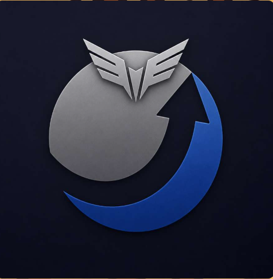

# Elythra Code

<div align="center">
  
  <h3>The Next-Generation AI-Native Code Editor</h3>
  <p>Single-window, zero bloat, BYOK (Bring Your Own Key), high-performance IDE.</p>
</div>

---

## 🌟 Overview

**Elythra Code** is an AI-powered desktop code editor designed for maximum speed, minimalist beauty, and autonomous coding assistance.

- **Unified Single Surface:** No "Open IDE" mode separation. When no workspace is open, a clean AI discussion studio is displayed. Opening a folder seamlessly transitions into the full Monaco-based IDE workspace.
- **BYOK (Bring Your Own Key):** Direct native integrations with:
  - OpenRouter (300+ models including Claude 3.5 Sonnet, DeepSeek V3/R1, Qwen 2.5 Coder, Llama 3.3)
  - Google Gemini API (Gemini 3.8 Flash, 2.5 Pro)
  - Anthropic Claude Direct API
  - OpenAI API (GPT-4o, o1, o3-mini)
  - DeepSeek Direct API
  - Groq Cloud (Ultra-fast LPU inference)
  - Local Ollama (`http://localhost:11434`)
  - Any custom OpenAI-compatible endpoint (vLLM / LMStudio / Jan)
- **Engineered for Speed:** Electron + Vite + React + Monaco Editor + xterm.js + Zustand.
- **Strictly Flat Dark Theme:** Minimalist palette (`#111111`, `#0f0f0f`, `#1f1f1f`, `#161616`, `#262626`).

---

## 🚀 Getting Started

### Prerequisites
- Node.js >= 20
- npm >= 10

### Installation
```bash
npm install
```

### Development Mode
```bash
npm run dev
# Or with Electron window:
npm run dev:electron
```

### Build & Package for Windows
```bash
npm run build
npm run pack:win    # Unpacked Windows directory
npm run dist:win    # Windows installer (NSIS & ZIP)
```

---

## 🤖 Automations & Custom Rules
Elythra Code includes built-in project automations (`Automations` tab in sidebar) to run tests or linting on save, and custom system instructions (`Customizations` tab) to guide AI behavior during pair programming.

---

## 📄 License
MIT License.
